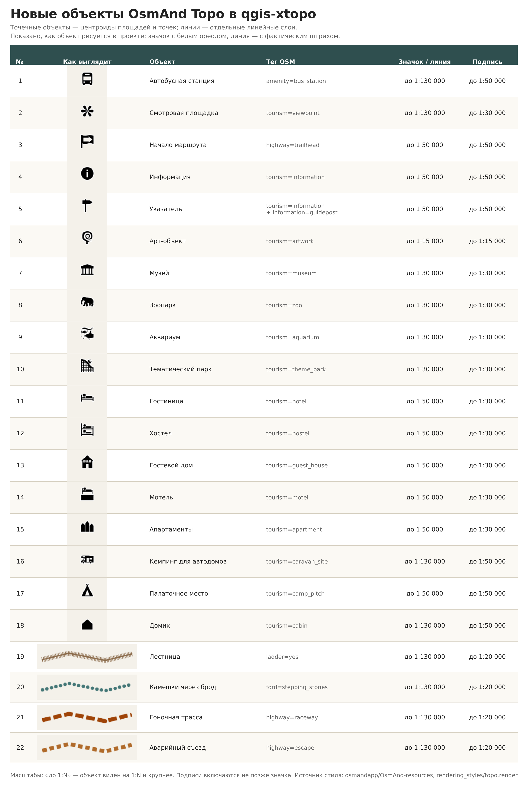

# Добавленные объекты OsmAnd Topo

Иллюстрированная таблица: как каждый объект рисуется в проекте и до какого
масштаба он виден.

Всего добавлено 22 слоя:

- 18 точечных: `bus_station`, `tourism=viewpoint`, `highway=trailhead`,
  `tourism=information` (отдельно `information=guidepost`), `artwork`,
  `museum`, `zoo`, `aquarium`, `theme_park`, `hotel`, `hostel`,
  `guest_house`, `motel`, `apartment`, `caravan_site`, `camp_pitch`,
  `cabin`;
- 4 линейных: `ladder=yes`, `ford=stepping_stones`, `highway=raceway`,
  `highway=escape`.

Значки взяты из Topo-стиля OsmAnd (`osmandapp/OsmAnd-resources`,
`rendering_styles/topo.render.xml`), приведены к чёрному силуэту. Правила
вытеснения значков, маски и подписи работают так же, как у остальных POI
проекта; линейные слои в вытеснении не участвуют, а их названия рисует
общее линейное правило до 1:20 000.
